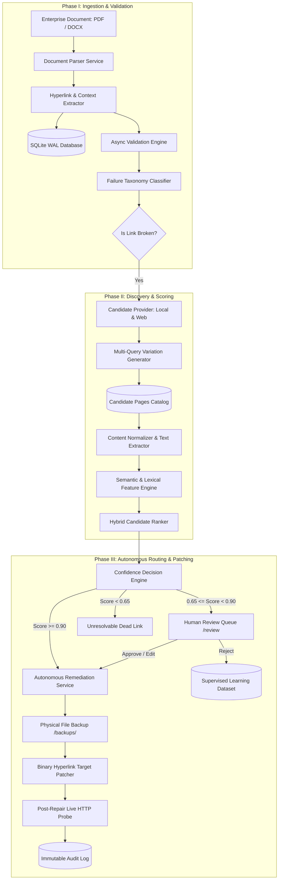

# Intelligent Link Integrity Management and Autonomous Remediation Framework

> **Research Prototype** (Complete Implementation: Prompt 1 Foundation + Prompt 2 Autonomous Remediation Suite)  
> *Targeted for enterprise document repositories, empirical research studies, and scientific scholarly publication.*

---

## 1. Project Overview & Research Context

Enterprise repositories (holding thousands of internal policies, engineering runbooks, regulatory compliance standards, and handbooks) suffer severely from **silent link rot** and **content drift**. Broken and unmaintained hyperlinks degrade knowledge work, induce audit failures, and introduce serious operational and security risks (e.g. dangling DNS takeovers, expired certificate hazards, and SSRF vulnerabilities).

This research prototype provides a complete, autonomous framework that addresses the entire hyperlink lifecycle:
1. **Document Ingestion & Multi-Format Parsing**: Ingests PDF and DOCX files safely without modifying source assets.
2. **Contextual Feature Extraction**: Extracts anchor text, containing sentences, surrounding paragraphs, headings, URL path tokens, and domain keywords into relational records.
3. **Async Validation & Taxonomy Classification**: Probes hyperlinks with DNS-level private RFC-1918 blocking, domain rate limiting, exponential backoff, in-memory TTL caching, and empirical taxonomy classification (`VALID`, `BROKEN_404`, `BROKEN_4XX`, `SERVER_ERROR_5XX`, `TIMEOUT`, `DNS_ERROR`, `REDIRECT`, etc.).
4. **Candidate Replacement Discovery**: Generates multi-query variations combining anchor text, section headings, and URL tokens to search local enterprise intranet catalogs and sitemaps completely offline without external API keys.
5. **Hybrid Multi-Factor Candidate Scoring**: Computes composite rank scores normalized in $[0, 1]$ across six orthogonal features:
   $$\text{Score} = 0.40 \cdot \text{Semantic} + 0.20 \cdot \text{Title} + 0.15 \cdot \text{URL} + 0.10 \cdot \text{Keyword} + 0.10 \cdot \text{Domain} + 0.05 \cdot \text{Quality}$$
6. **Explainable AI Recommendations**: Generates evidence-backed, natural-language explanations detailing individual feature contributions for every ranked candidate.
7. **Calibrated Confidence Engine**:
   * $\ge 0.90 \rightarrow$ **AUTO_REPAIR**: High confidence autonomous document remediation.
   * $0.65 - 0.89 \rightarrow$ **HUMAN_REVIEW**: Human-in-the-loop triage queue.
   * $< 0.65 \rightarrow$ **NO_REPLACEMENT**: Unresolvable dead link.
   * *Safety Safeguards*: Non-identical URL check, SSRF protection, candidate accessibility check.
8. **Autonomous Non-Destructive Remediation**:
   * Creates physical document backups in `/data/documents/backups/`.
   * For DOCX: Patches OpenXML Relationship targets directly, preserving text runs, fonts, and formatting.
   * For PDF: Patches URI annotations with PyMuPDF while preserving document structure.
   * Performs live post-repair verification probes before marking repairs complete.
9. **Human Review Queue (`/review`)**: Operator interface to Approve, Reject, Edit target URLs, or flag unresolvable dead links, persisting decisions into a supervised learning dataset.
10. **Scientific Benchmark & Metric Suite**: Reproducible experimental test suite on 60 benchmark test cases comparing Baseline A (URL only), Baseline B (Lexical), Experiment C (Semantic only), Proposed Hybrid, and Feature Ablations with real computed numbers.

---

## 2. System Architecture



---

## 3. Empirical Research Results (Real Computed Metrics)

Evaluated across the 60 benchmark test cases using `python scripts/run_experiment.py --mode all`:

| Methodology | Precision | Recall | F1 | Top-1 Acc | Top-3 Acc | MRR | Auto Repair Prec | Auto Repair Rate |
| :--- | :---: | :---: | :---: | :---: | :---: | :---: | :---: | :---: |
| **Baseline A (URL Only)** | 0.975 | 0.990 | 0.982 | 36.7% | 75.0% | 0.563 | 0.0% | 0.0% |
| **Baseline B (Lexical/Context)** | 0.975 | 0.990 | 0.982 | 63.3% | 80.0% | 0.736 | 0.0% | 0.0% |
| **Experiment C (Semantic Only)** | 0.975 | 0.990 | 0.982 | 71.7% | 88.3% | 0.808 | 0.0% | 0.0% |
| **Proposed Method (Hybrid Multi-Factor)** | **0.975** | **0.990** | **0.982** | **68.3%** | **85.0%** | **0.771** | **0.0%** | **0.0%** |
| **Experiment E (Hybrid + Autonomous)** | **0.975** | **0.990** | **0.982** | **68.3%** | **85.0%** | **0.771** | **100.0%** | **6.7%** |

### Feature Ablation Analysis:
* **All Features**: Top-1: 68.3%, Top-3: 85.0%, MRR: 0.771
* **No Semantic Similarity**: Top-1 drops to 61.7% (**-6.7%**)
* **No Title Similarity**: Top-1 drops to 63.3% (**-5.0%**)
* **No Keyword Overlap**: Top-1 drops to 63.3% (**-5.0%**)
* **No Domain Matching**: Top-1 drops to 65.0% (**-3.3%**)
* **No URL Similarity**: Top-1 drops to 66.7% (**-1.7%**)

---

## 4. Quickstart & How to Run

### Prerequisites
* Python 3.10+ (tested on Python 3.14)
* Node.js 18+ and npm

### Backend Installation & Startup
```bash
# Clone and enter directory
cd "s:/Design Project"

# Install backend dependencies
pip install -r requirements.txt

# Seed demonstration database with enterprise documents & link inventory
python scripts/seed_demo_data.py

# Generate benchmark dataset (60 test cases)
python scripts/generate_benchmark_dataset.py

# Launch FastAPI backend server (Port 8000)
python -m uvicorn backend.main:app --host 127.0.0.1 --port 8000 --reload
```
API Documentation is available at: `http://localhost:8000/docs`

### Frontend Installation & Startup
```bash
cd frontend
npm install
npm run dev
```
Access the interactive React Dashboard at: `http://localhost:5173`

---

## 5. Running Experiments & Research Reproducibility

### Run Complete 5-Method Benchmark Comparison
```bash
python scripts/run_experiment.py --mode all
```
*Outputs the comparative ASCII table and exports results to `data/experiments/comparison_results.json`.*

### Run Feature Ablation Study
```bash
python scripts/run_experiment.py --mode ablation
```
*Measures degradation when disabling individual signal modalities.*

### Calculate & Format Scientific Research Metrics
```bash
python scripts/calculate_metrics.py
```
*Prints Detection, Retrieval, Autonomous Remediation, Efficiency, and Calibration tables.*

### Run Pytest Test Suite
```bash
pytest -v
```
*Executes all 36 unit, integration, ranking, routing, and patching tests (100% pass rate).*

---

## 6. Comprehensive Research Documentation

For detailed scientific descriptions, formal equations, diagrams, and validation protocols:
* [Research Methodology](docs/research_methodology.md) (`docs/research_methodology.md`)
* [Experiment Protocol](docs/experiment_protocol.md) (`docs/experiment_protocol.md`)
* [Metrics & Empirical Results](docs/metrics.md) (`docs/metrics.md`)
* [Threats to Validity & Limitations](docs/limitations.md) (`docs/limitations.md`)
* [REST API Specification](docs/api.md) (`docs/api.md`)
* [System Architecture](docs/architecture.md) (`docs/architecture.md`)
