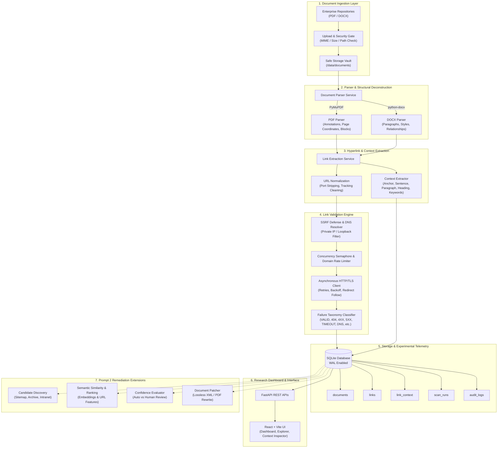
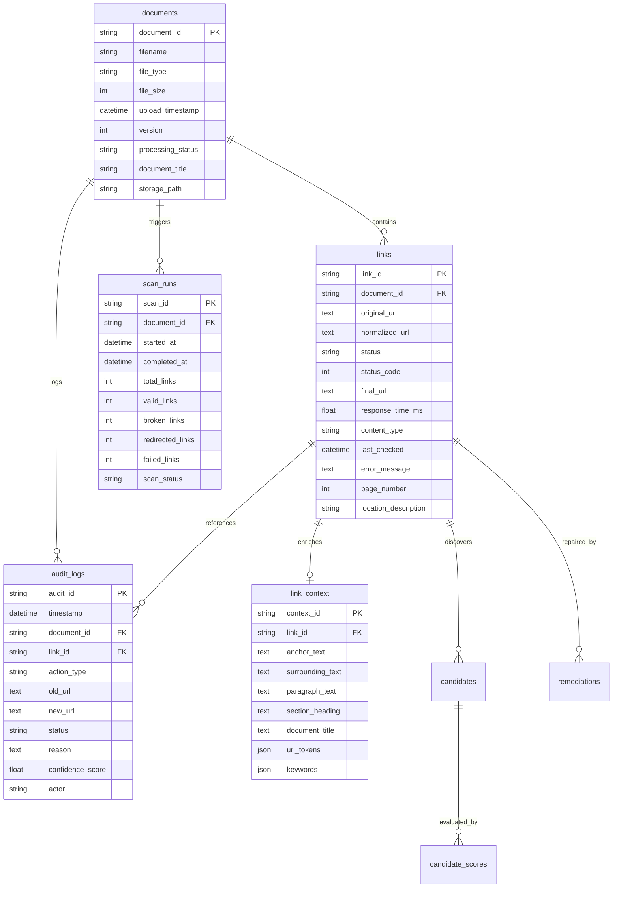

# System Architecture: Intelligent Link Integrity Management Framework

## 1. Executive Summary & Research Motivation

In enterprise documentation ecosystems (containing thousands of engineering playbooks, human resource policies, regulatory compliance guides, and standard operating procedures), hyperlinks decay at an alarming rate—a phenomenon known as *link rot* and *content drift*. Outdated or broken links degrade operational efficiency, disrupt onboarding, cause compliance failures, and introduce severe security vulnerabilities (e.g., dangling domain takeovers and server-side request forgery vectors).

This framework provides an end-to-end autonomous research architecture that continuously ingests enterprise documents (PDF and DOCX), extracts embedded hyperlinks alongside deep linguistic and structural context, performs asynchronous validation against an empirical failure taxonomy, maintains immutable audit trails, and lays the formal foundation for downstream candidate discovery, semantic similarity ranking, and autonomous remediation.

---

## 2. Research Pipeline Architecture

---

## 3. Core Architectural Subsystems

### 3.1 Document Ingestion & Storage
- **File Validation**: Strict multi-stage validation inspecting extensions (`.pdf`, `.docx`), verified MIME types, and maximum payload size (50 MB).
- **Safe Immutability**: Uploaded documents are saved under sanitized, timestamped paths inside `/data/documents/`. The original source files are strictly immutable and never altered during the validation phase.
- **Deduplication & Metadata**: SHA-256 integrity digests, page counts, and version numbers are cataloged in the database.

### 3.2 Parsing & Positional Layout Analysis
- **PDF Engine (`PyMuPDF`)**:
  - Extracts interactive PDF link annotations (`LINK_URI`) alongside explicit bounding boxes (`Rect`).
  - Correlates link coordinates (`y0`) with structural text blocks to isolate section headings and paragraph text without spatial distortion.
  - Recovers text-embedded URLs using regex matching with page coordinate mapping.
- **DOCX Engine (`python-docx`)**:
  - Traverses paragraph XML structures, inspecting `w:hyperlink` relationships mapped to document relationship parts (`r:id`).
  - Tracks hierarchical heading styles (`Heading 1`, `Heading 2`, `Title`) and paragraph indexes to preserve contextual origin.

### 3.3 Context Extraction Architecture
To enable downstream semantic ranking without re-parsing, each link generates a companion `link_context` record:
- **Anchor / Display Text**: The human-visible text providing user intent.
- **Surrounding Sentence**: Isolated using boundary detection heuristics around the link's occurrence.
- **Paragraph Context**: The full parent paragraph providing topic coherence.
- **Structural Heading**: The immediate enclosing section header.
- **URL Decomposition Tokens**: Protocol, domain, path hierarchy, filename, query parameters, and alphanumeric terms.
- **Domain Keywords**: Frequency-weighted domain terms filtered against extensive stopword lists.

### 3.4 Asynchronous Validation Engine
- **SSRF Hardening**: Inspects target hostnames, performs pre-request DNS resolution, and halts execution if the destination resolves to loopback (`127.0.0.0/8`, `::1`), private RFC-1918 subnets (`10.0.0.0/8`, `172.16.0.0/12`, `192.168.0.0/16`), link-local metadata addresses (`169.254.169.254`), or internal `.local`/`.internal` suffixes.
- **Bounded Concurrency**: Global async semaphore restricts total concurrent requests (default: 10), preventing socket exhaustion.
- **Domain Rate Limiting**: Per-domain semaphores prevent hammering single destination hosts.
- **Validation Cache**: Thread-safe in-memory cache with configurable TTL (default: 3600s) prevents redundant network overhead.
- **Failure Taxonomy**:
  - `VALID`: HTTP 200–299
  - `REDIRECT`: HTTP 301, 302, 307, 308 (tracks hop count and final location)
  - `BROKEN_404`: HTTP 404 Not Found
  - `BROKEN_4XX`: Other client-side errors (400, 410 Gone, 429)
  - `SERVER_ERROR_5XX`: Remote internal server errors (500, 502 Bad Gateway, 503)
  - `FORBIDDEN` / `UNAUTHORIZED`: HTTP 403 / 401
  - `TIMEOUT`: Request duration exceeded limit (default: 10.0s)
  - `DNS_ERROR`: Domain name resolution failure (`socket.gaierror`)
  - `CONNECTION_ERROR`: Socket reset, connection refused, or remote protocol failure
  - `INVALID_URL`: Malformed syntax or blocked by SSRF

---

## 4. Database Schema Design (SQLite + WAL Mode)

---

## 5. Forward-Compatibility for Prompt 2

Prompt 2 introduces AI-driven candidate discovery and autonomous remediation. The architecture prepares for this via:
1. **Relational Schema Placeholders**: Complete table models (`candidates`, `candidate_scores`, `remediations`, `review_queue`, `experiment_runs`) already defined with foreign key relationships.
2. **Modular Service Interfaces**: `backend/app/services/interfaces.py` specifies abstract protocols for:
   - `CandidateProvider`: Discovery across internal search indexes, web archives, and corporate sitemaps.
   - `SemanticSimilarityService`: Cosine similarity over context embeddings and candidate documents.
   - `CandidateRankingService`: Multi-factor composite ranking.
   - `ConfidenceService`: Automated thresholding between auto-patching and human-in-the-loop review.
   - `RemediationService`: Non-destructive document patching.
   - `ExperimentService`: Scientific metric tracking (Precision, Recall, MRR, Repair Accuracy).
