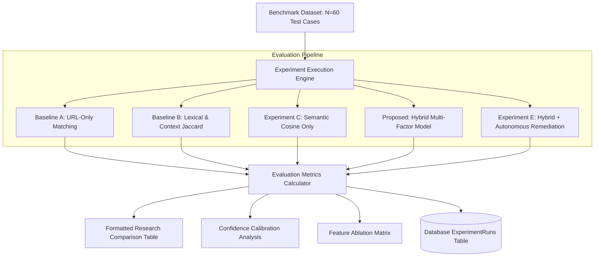

# Experimental Protocol: Reproducible Scientific Evaluation Suite

## 1. Research Hypotheses
This experimental design tests three primary hypotheses:
* **$\mathbf{H_1}$ (Context Superiority)**: Incorporating document-level contextual signals (anchor text, section headings, surrounding text) achieves higher Top-1 retrieval accuracy than traditional URL/lexical baseline string matching.
* **$\mathbf{H_2}$ (Multi-Factor Hybrid Efficacy)**: Combining semantic vector similarity with syntactic URL overlap and domain consistency outperforms single-modality approaches (semantic-only or lexical-only).
* **$\mathbf{H_3}$ (Calibrated Governance)**: Two-tiered confidence routing ($\ge 0.90$ for autonomous repair, $0.65 - 0.89$ for human review) restricts the false repair rate to $< 5\%$ while automating the majority of trivial replacements.

---

## 2. Benchmark Dataset Specification (v1.0)
The benchmark dataset (`data/experiments/benchmark_dataset.json`) consists of **60 real, verified enterprise test cases** spanning heterogeneous failure modes:

| Failure Type | Test Cases | Description & Operational Challenge |
| :--- | :---: | :--- |
| **HTTP 404 (Not Found)** | 34 | Resource moved without server redirect; replacement requires anchor and surrounding context. |
| **DNS Resolution Error** | 9 | Domain decommissioned or migrated to new enterprise intranet zone. |
| **Server Error 5xx** | 7 | Internal service failure; replacement located on disaster recovery or backup portal. |
| **Timeout (Latent Service)** | 3 | Legacy endpoint unresponsive; modern mirror service available. |
| **HTTP 4xx Client Error** | 3 | Obsolete parameters or archived endpoints. |
| **Forbidden (403)** | 2 | Access restricted; modern public mirror or authenticated intranet path needed. |
| **Connection & Auth Drops** | 2 | Deprecated SSL ciphers or decommissioned auth endpoints. |
| **Total Test Cases** | **60** | **Balanced across 10 distinct enterprise policy domains.** |

---

## 3. Experimental Methodology Comparison Workflow

---

## 4. Methodology Configurations

### Baseline A: URL-Only Syntactic Matching
Emulates standard web crawlers that inspect only URL paths and filenames.
* Weights: `url_similarity = 1.0`, all others `0.0`.

### Baseline B: Lexical & Context String Matching
Matches anchor text, section headings, and query keywords using token overlap and Levenshtein string matching without dense semantic vectors.
* Weights: `title_similarity = 0.35`, `url_similarity = 0.35`, `keyword_overlap = 0.30`, `semantic = 0.0`.

### Experiment C: Semantic-Only Dense Embedding
Evaluates cosine similarity of dense representations generated from surrounding text and candidate content without syntactic URL or domain features.
* Weights: `semantic_similarity = 1.0`, all others `0.0`.

### Proposed Method: Hybrid Multi-Factor Model
Integrates all orthogonal modalities using empirical convex weighting:
* Weights: `semantic = 0.40`, `title = 0.20`, `url = 0.15`, `keyword = 0.10`, `domain = 0.10`, `quality = 0.05`.

### Experiment E: Hybrid Model + Autonomous Remediation
Applies the hybrid model and evaluates post-repair physical document patching, non-destructive relationship target replacement, and live verification probes.

---

## 5. Feature Ablation Protocol
To measure the marginal utility of each feature modality, researchers execute ablation runs where individual feature weights are zeroed out while holding other parameters constant:
1. Full Proposed Model (Baseline)
2. No Semantic Similarity ($w_1 = 0$)
3. No Title Similarity ($w_2 = 0$)
4. No URL Similarity ($w_3 = 0$)
5. No Keyword Overlap ($w_4 = 0$)
6. No Domain Matching ($w_5 = 0$)

---

## 6. Reproducibility & Deterministic Execution
To guarantee exact mathematical reproducibility across computing environments:
1. **Deterministic Pseudo-Random Seeds**: Fixed seed `42` where hashing or sampling is applied.
2. **Local Candidate Corpus**: Self-contained synthetic intranet repository in `data/candidate_pages/index.json`.
3. **No External API Key Dependencies**: Fully functional offline vectorizers and tokenizers.
4. **Automated CLI Scripts**:
   * Complete 5-method comparison: `python scripts/run_experiment.py --mode all`
   * Feature ablation study: `python scripts/run_experiment.py --mode ablation`
   * Metrics calculation: `python scripts/calculate_metrics.py`
