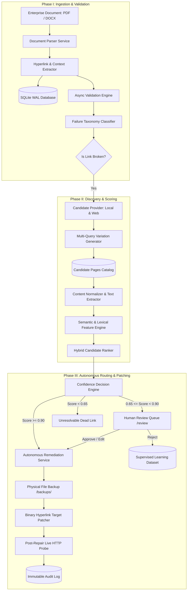
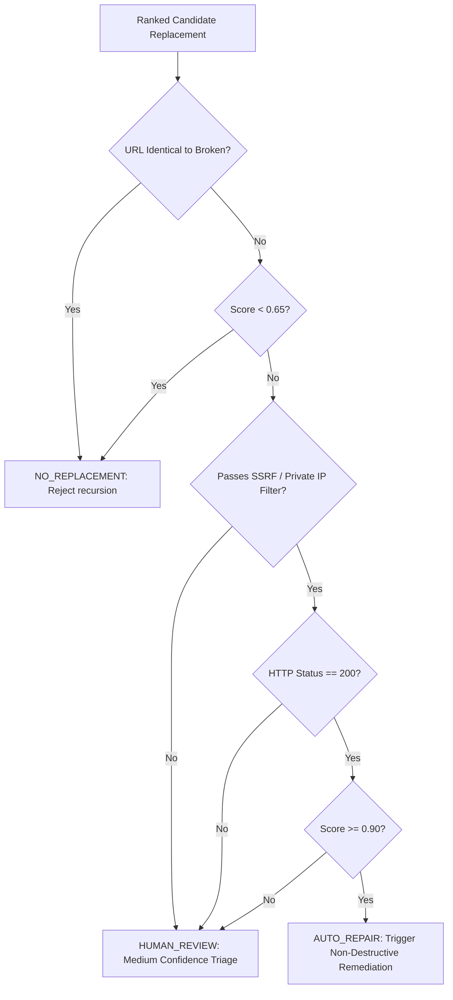
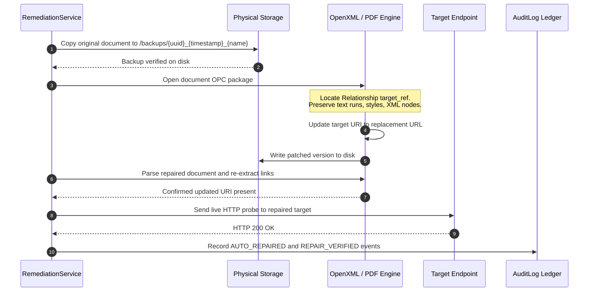
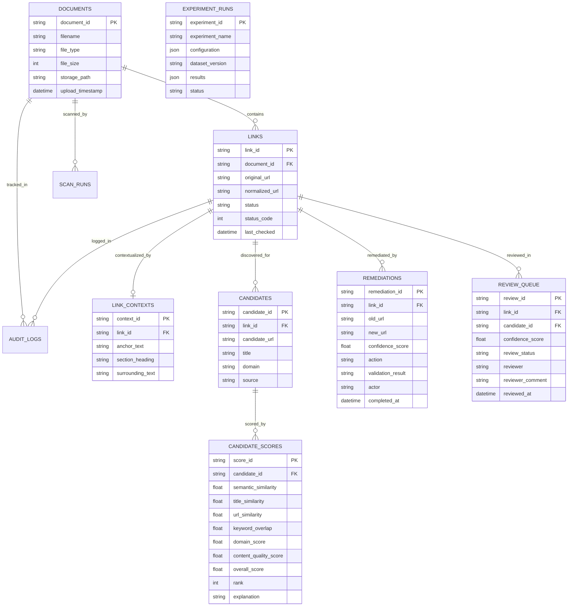

# Research Methodology: Intelligent Link Integrity Management and Autonomous Remediation Framework

## 1. Research Problem and Motivation
Enterprise document repositories (containing standard operating procedures, architectural designs, compliance guidelines, and HR handbooks) suffer from **silent link rot**. As web services, intranet portals, and corporate wikis evolve, hyperlinks embedded in static documents (PDF, DOCX) become dead endpoints, returning HTTP 404s, DNS failures, or landing on stale redirections.

Existing industry tools rely on manual verification or simple status pingers. They fail to:
1. Extract semantic context (anchor text, section headings, surrounding prose).
2. Discover context-aware replacements when URLs change without redirects.
3. Calibrate confidence to decide between autonomous document patching and human review.
4. Perform non-destructive physical patching of binary document formats while maintaining verifiable audit trails.

This research presents a complete, closed-loop framework for automated broken link detection, hybrid multi-signal candidate replacement retrieval, explainable confidence routing, and non-destructive autonomous remediation.

---

## 2. System Architecture

---

## 3. Mathematical Formulation of the Hybrid Ranking Model

Given a broken link $L$ in document context $C = (T_{doc}, H_{sec}, A_{txt}, P_{ctx}, K_{src})$ and a candidate resource $R = (U_{cand}, T_{cand}, B_{cand}, D_{cand})$, the overall matching score $S(L, R) \in [0, 1]$ is a convex combination of six orthogonal features:

$$
S(L, R) = \sum_{i=1}^{6} w_i \cdot f_i(L, R)
$$

Where $\sum_{i=1}^{6} w_i = 1.0$, with default baseline weights:
* $w_1 = 0.40$ (Semantic Similarity)
* $w_2 = 0.20$ (Title Similarity)
* $w_3 = 0.15$ (URL Similarity)
* $w_4 = 0.10$ (Keyword Overlap)
* $w_5 = 0.10$ (Domain Score)
* $w_6 = 0.05$ (Content Quality Score)

### Feature Formulations

1. **Semantic Similarity ($f_1 \in [0, 1]$)**:
   Computes the cosine similarity between the L2-normalized TF-IDF sublinear N-gram embedding of the source context $\mathbf{v}_{src}$ and candidate document representation $\mathbf{v}_{cand}$, calibrated via a logistic projection:
   $$
   \text{sim}_{raw} = \frac{\mathbf{v}_{src} \cdot \mathbf{v}_{cand}}{\|\mathbf{v}_{src}\|_2 \|\mathbf{v}_{cand}\|_2}, \quad f_1 = \frac{1}{1 + e^{-12(\text{sim}_{raw} - 0.22)}}
   $$

2. **Title Similarity ($f_2 \in [0, 1]$)**:
   Measures asymmetric token containment of anchor text $A_{txt}$ within candidate title $T_{cand}$ combined with sequence gestalt ratio:
   $$
   f_2 = \max \left( \text{Ratio}(A_{txt}, T_{cand}), \frac{|Tokens(A_{txt}) \cap Tokens(T_{cand})|}{\min(|Tokens(A_{txt})|, |Tokens(T_{cand})|)} \right)
   $$

3. **URL Syntactic Similarity ($f_3 \in [0, 1]$)**:
   Evaluates path segment token overlap and character sequence edit distance between path $U_{old}$ and $U_{cand}$:
   $$
   f_3 = 0.70 \cdot \frac{|Tokens(P_{old}) \cap Tokens(P_{cand})|}{\max(1, \min(|Tokens(P_{old})|, |Tokens(P_{cand})|))} + 0.30 \cdot \text{LevenshteinRatio}(P_{old}, P_{cand})
   $$

4. **Keyword Overlap ($f_4 \in [0, 1]$)**:
   $$
   f_4 = \frac{|K_{src} \cap B_{cand}|}{|K_{src}|}
   $$

5. **Domain Consistency Score ($f_5 \in [0, 1]$)**:
   $$
   f_5 = \begin{cases}
   1.0 & \text{if } \text{Domain}(U_{old}) = \text{Domain}(U_{cand}) \\
   0.8 & \text{if corporate subdomain match} \\
   0.7 & \text{if intranet corporate authority domain} \\
   0.3 & \text{otherwise}
   \end{cases}
   $$

6. **Content Quality & Accessibility ($f_6 \in [0, 1]$)**:
   $$
   f_6 = \begin{cases}
   1.0 & \text{if accessible, HTTP 200, and } |B_{cand}| > 500 \text{ chars} \\
   0.7 & \text{if accessible and } |B_{cand}| > 150 \text{ chars} \\
   0.0 & \text{if HTTP status } \ge 400 \text{ or inaccessible}
   \end{cases}
   $$

---

## 4. Confidence Routing and Safeguard Rules

---

## 5. Non-Destructive Autonomous Remediation Workflow

---

## 6. Database Entity Relationship Diagram

